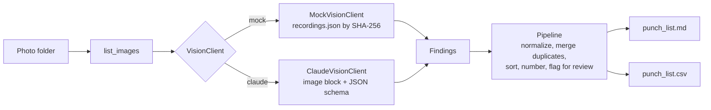

# photo-to-punch-list

Turns a folder of job site photos into a punch list a crew can work from, grouped by room and trade.

**The problem.** A closeout walkthrough produces a camera roll, not a to-do list. Someone then retypes every photo into "which room, which trade, what needs fixing" before any tradesperson can act on it.

**Who it is for.** Small contractors, remodelers and property managers closing out jobs or turning over units.

**What it does.** Point it at a folder of photos. A vision model lists the defects it can see in each one, and the tool turns that into one checklist (Markdown) and one spreadsheet (CSV):

- every item has a room, a trade, a severity and the photos it came from
- the same defect seen in two photos becomes one item, not two
- anything the model was unsure about is marked "needs review"
- photos that could not be read are listed with the reason, not silently dropped

**What is proven here.** The demo, the tests and CI run offline on recorded responses for seven synthetic sample images. The live Claude client is written and unit tested against a fake SDK, but has not been run against the real API in this repository. See [Limitations](#limitations).

## What you will see

`python demo/run_demo.py` needs no install, no network and no API key. Trimmed from its real output (full capture in [`demo/output.txt`](demo/output.txt)):

```
client: mock
photos: 7 (1 skipped)
items:  16 across 5 rooms

## Kitchen

### Electrical

- [ ] **PL-010** [high] Outlet to the right of the sink has no cover plate. (photos: kitchen_01.png, kitchen_02.png)

### Flooring

- [ ] **PL-011** [medium] Chipped tile at the dishwasher edge. (needs review) (photos: kitchen_02.png)

## Photos not analyzed

- unknown_01.png: image is too dark to analyze
```

PL-010 is one defect recorded from two photos, once as "Electrical / high" and once as "electric / medium"; it was merged and kept the worse severity. PL-011 was recorded at 0.50 confidence, below the 0.6 review threshold. The same run writes [`demo/punch_list.md`](demo/punch_list.md) and [`demo/punch_list.csv`](demo/punch_list.csv).

The sample images are flat colour placeholder rectangles generated by `scripts/make_samples.py`, not photographs, and every finding in `samples/recordings.json` is invented.

## How it works

- Sends each photo to a vision model and gets back structured findings: room, trade, description, severity, confidence.
- Normalizes trades to a fixed list ("electric" becomes Electrical, anything unrecognized becomes General) and tidies room names ("main bath" becomes Bathroom, blank becomes Unknown).
- Merges the same defect seen in two photos into one item that cites both photos, keeping the worse severity.
- Flags low confidence findings as "needs review" instead of dropping them or presenting them as certain.
- Records photos that could not be analyzed, including formats the API does not accept such as HEIC, and keeps going.
- Writes `punch_list.md` (checkbox list by room, then trade, with a summary table) and `punch_list.csv` (one row per item, ready for a spreadsheet).

The vision model sits behind a small interface (`VisionClient.analyze(image_path) -> list[Finding]`) with two implementations:

| Client | Needs | Use |
|---|---|---|
| `mock` (default) | nothing | Replays recorded responses for the bundled sample images, keyed by SHA-256 of the image bytes. Tests, demo and CI run on this. |
| `claude` | `anthropic` package and an API key | One Messages API request per photo: base64 image block in, JSON constrained by a schema out. Model id is configurable, default `claude-sonnet-5-5`. Not yet run against the live API here. |

## Architecture



Source layout:

```
src/punchlist/
  vision.py         the VisionClient interface, supported image types
  mock_client.py    recorded responses, offline
  claude_client.py  Claude Messages API implementation
  pipeline.py       normalize, dedupe, sort, number
  render.py         Markdown and CSV writers
  cli.py            command line entry point
samples/            synthetic placeholder images and their recordings
scripts/make_samples.py   regenerates the placeholder images (standard library only)
```

## Run it

The core has no dependencies. With Python 3.10 or newer, in a virtual environment:

```
pip install -e ".[dev]"
punchlist --images samples/images --out out --project "Sample Unit 4B"
```

That runs the mock client on the bundled samples and writes `out/punch_list.md` and `out/punch_list.csv`.

To use a real model on your own photos (JPEG, PNG, GIF or WebP), set `ANTHROPIC_API_KEY` in your environment, then:

```
pip install -e ".[claude]"
punchlist --images path/to/photos --out out --client claude
```

This path sends your photos to the Anthropic API and is billed to your key. The tool reads settings from the environment only; `.env.example` lists them but is not loaded.

Configuration, all optional (see `.env.example`):

| Variable | Default | Meaning |
|---|---|---|
| `ANTHROPIC_API_KEY` | none | Required only for `--client claude` |
| `PUNCHLIST_MODEL` | `claude-sonnet-5-5` | Vision model id; `--model` overrides it |
| `PUNCHLIST_EFFORT` | `medium` | Sent as `output_config.effort` |
| `PUNCHLIST_REVIEW_THRESHOLD` | `0.6` | Confidence below this is flagged for review |

## Tests

```
pytest -q
```

27 tests, all offline. The Claude client is tested against a fake SDK object that captures the request, so the request shape (base64 image block, JSON schema, model id) and the response handling (refusal, truncation, malformed JSON) are covered without a key. CI (`.github/workflows/ci.yml`) runs the tests and the demo on Python 3.10 and 3.12.

## Demo

```
python demo/run_demo.py
```

Runs the seven bundled sample images through the mock client, rewrites `demo/punch_list.md` and `demo/punch_list.csv`, and prints both. The seventh sample has a recorded failure so the "Photos not analyzed" section is exercised too.

## Design choices

These are the parts meant to carry over to a real deployment: the model sits behind an interface so the whole flow runs and tests offline, output is constrained by a schema instead of parsed from prose, a fixed trade vocabulary is applied after the model rather than trusted from it, and uncertain or failed inputs are surfaced in the output rather than hidden.

## Limitations

What is mocked or unproven:

- The demo, the tests and CI never call a vision model. They replay `samples/recordings.json`, which was written by hand. Nothing here measures how well a model finds real defects.
- The Claude client has never been run against the live API in this repository. Its request shape was checked against the SDK's `messages.create` parameters and its response handling is tested with a fake client, but no real photo and no real API key have gone through it. Expect to tune the prompt on real photos.
- The sample images are coloured rectangles, not photographs. There are no accuracy, speed or cost figures because none have been measured.
- The mock client only knows the seven bundled sample images. Any other image is listed under "Photos not analyzed", and if every photo fails the command exits with status 1.

What the tool does not do:

- Duplicate merging is exact match on room, trade and description after lowercasing and stripping punctuation. A model that words the same defect two ways across two photos will produce two items.
- Room names come from what the model can see in one photo. There is no floor plan, no photo metadata and no cross photo context, so a close up of a wall will often come back as "Unknown". Only a few room aliases are built in; other names pass through as the model wrote them.
- HEIC, HEIF, TIFF and BMP files are reported as not analyzed, not converted. Phone photos saved as HEIC need converting to JPEG first. Photos are not resized either, so one over the API's image size limit will fail and be listed as not analyzed.
- Photos are sent one per request, sequentially, with no retry beyond what the SDK does, no batching and no cost tracking. A bad API key fails once per photo.
- Re-running starts from scratch: item numbers are assigned per run and the CSV `status` column is always "open". There is no tracking of items across runs.
- A vision model can miss defects and can report ones that are not there. The output is a draft for a person to walk and confirm, not an inspection record.
- Unrecognized trades fall into "General" (the sample "Glazing" finding shows this). The trade and room alias tables are short and meant to be edited.

License: MIT, see the LICENSE file.
