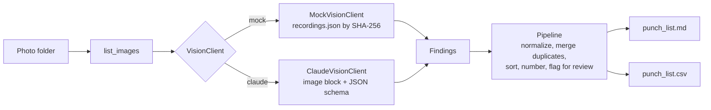

# photo-to-punch-list

A walkthrough at the end of a job produces a camera roll, not a to-do list. Someone then has to retype every photo into "which room, which trade, what needs fixing" before any tradesperson can act on it.

This tool does that retyping: point it at a folder of job site photos and it writes a punch list grouped by room and trade, as Markdown and CSV.

## What it does

- Sends each photo to a vision model and gets back structured findings: room, trade, description, severity, confidence.
- Normalizes rooms and trades to a fixed vocabulary ("electric" becomes Electrical, "main bath" becomes Bathroom, anything unrecognized becomes General).
- Merges the same defect seen in two photos into one item that cites both photos, keeping the worse severity.
- Flags low confidence findings as "needs review" instead of dropping them or presenting them as certain.
- Records photos that could not be analyzed in the output and keeps going.
- Writes `punch_list.md` (checkbox list by room, then trade, with a summary table) and `punch_list.csv` (one row per item, ready for a spreadsheet).

The vision model sits behind a small interface (`VisionClient.analyze(image_path) -> list[Finding]`) with two implementations:

| Client | Needs | Use |
|---|---|---|
| `mock` (default) | nothing | Replays recorded responses for the bundled sample images, keyed by SHA-256 of the image bytes. Tests, demo and CI run on this. |
| `claude` | `anthropic` package and an API key | One Messages API request per photo: base64 image block in, JSON constrained by a schema out. Model id is configurable, default `claude-sonnet-5-5`. |

## Architecture



Source layout:

```
src/punchlist/
  vision.py         the VisionClient interface, supported image types
  mock_client.py    recorded responses, offline
  claude_client.py  Claude Messages API implementation
  pipeline.py       normalize, dedupe, sort, number
  render.py         Markdown and CSV writers
  cli.py            command line entry point
samples/            synthetic placeholder images and their recordings
scripts/make_samples.py   regenerates the placeholder images (standard library only)
```

## Run it

The core has no dependencies. With Python 3.10 or newer (a virtual environment is recommended):

```
pip install -e ".[dev]"
punchlist --images samples/images --out out --project "Sample Unit 4B"
```

To use a real model on your own photos:

```
pip install -e ".[claude]"
cp .env.example .env    # then export the values; the tool reads the environment, not the file
punchlist --images path/to/photos --out out --client claude
```

Configuration, all optional (see `.env.example`):

| Variable | Default | Meaning |
|---|---|---|
| `ANTHROPIC_API_KEY` | none | Required only for `--client claude` |
| `PUNCHLIST_MODEL` | `claude-sonnet-5-5` | Vision model id; `--model` overrides it |
| `PUNCHLIST_EFFORT` | `medium` | Sent as `output_config.effort` |
| `PUNCHLIST_REVIEW_THRESHOLD` | `0.6` | Confidence below this is flagged for review |

## Tests

```
pytest -q
```

22 tests, all offline. The Claude client is tested against a fake SDK object that captures the request, so the request shape (base64 image block, JSON schema, model id) and the response handling (refusal, truncation, malformed JSON) are covered without a key. CI (`.github/workflows/ci.yml`) runs the tests and the demo on Python 3.10 and 3.12.

## Demo

```
python demo/run_demo.py
```

Needs no install, no network and no key. It runs the seven bundled sample images through the mock client and prints both outputs. A captured run is in [`demo/output.txt`](demo/output.txt), with the generated files in [`demo/punch_list.md`](demo/punch_list.md) and [`demo/punch_list.csv`](demo/punch_list.csv). Excerpt:

```
## Kitchen

### Electrical

- [ ] **PL-010** [high] Outlet to the right of the sink has no cover plate. (photos: kitchen_01.png, kitchen_02.png)

### Flooring

- [ ] **PL-011** [medium] Chipped tile at the dishwasher edge. (needs review) (photos: kitchen_02.png)
```

PL-010 is one defect reported from two photos, once as "Electrical / high" and once as "electric / medium". PL-011 came back at 0.50 confidence. The seventh sample has a recorded failure so the "Photos not analyzed" section is exercised too.

The sample images are flat colour placeholder rectangles generated by `scripts/make_samples.py`, not photographs, and every finding in `samples/recordings.json` is invented.

## Where this pattern runs

This is drawn from systems that run two small service companies day to day, where field photos arrive faster than anyone can write them up. The parts that carry over are the ones shown here: the model behind an interface so the whole flow runs and tests offline, schema constrained output instead of parsing prose, a fixed vocabulary applied after the model rather than trusted from it, and uncertain or failed inputs surfaced in the output rather than hidden.

## Limitations

- The Claude client has not been run against the live API in this repository. Its request was checked against the SDK's parameter types and its behaviour is tested with a fake client, but no real photo has gone through it here. Expect to tune the prompt on real photos.
- The mock client only knows the bundled sample images. Any other image raises an error by design.
- Duplicate merging is exact match on room, trade and description after lowercasing and stripping punctuation. A model that words the same defect two ways across two photos will produce two items.
- Room names come from what the model can see in one photo. There is no floor plan, no photo metadata and no cross photo context, so a close up of a wall will often come back as "Unknown".
- Photos are sent one per request, sequentially, with no retry beyond what the SDK does, no batching and no cost tracking.
- A vision model can miss defects and can report ones that are not there. The output is a draft for a person to walk and confirm, not an inspection record.
- Unrecognized trades fall into "General" (the sample "Glazing" finding shows this). The trade and room alias tables are short and meant to be edited.

License: MIT, see the LICENSE file.
